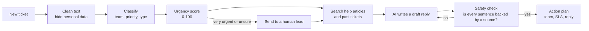

# Customer Support Intelligence Platform

[](https://github.com/nikhitha-sk/customer-support-intelligence/actions/workflows/tests.yml)

A project that helps a customer-support team work faster. It reads support tickets and:

1. **Sends each ticket to the right team** (for example "Billing" or "IT Support").
2. **Decides how urgent it is** and explains why.
3. **Finds common complaints** across thousands of tickets.
4. **Writes a draft reply** using the company's help articles, with sources.

You can use it through a **web dashboard** (Streamlit) or a **REST API** (FastAPI).

---

## Table of contents

- [The problem](#the-problem)
- [How a ticket moves through the system](#how-a-ticket-moves-through-the-system)
- [Key words explained](#key-words-explained)
- [The data](#the-data)
- [Results](#results)
- [Features](#features)
- [How to run it](#how-to-run-it)
- [API](#api)
- [Project folders](#project-folders)
- [Tech stack](#tech-stack)
- [Progress log](#progress-log)
- [What is next](#what-is-next)

---

## The problem

A support team gets thousands of tickets. Today a person reads each one and decides where it goes. This causes three problems:

- **It is slow.** Sorting tickets by hand takes time.
- **Urgent tickets wait.** A website outage or a hacked account sits in the same line as a simple question.
- **Agents repeat work.** They write the same answers again and again.

We turn each business question into an AI task:

| Business question | AI task | Where in the code |
|---|---|---|
| Which team should get this ticket? | Text classification (10 teams) | `csi/models/` |
| How urgent is it, and why? | Priority prediction + sentiment + risk words → score from 0 to 100 | `csi/nlp/urgency.py` |
| What are customers complaining about? | Group similar tickets into themes (clustering) | `csi/nlp/topics.py` |
| How can we reply faster? | Search help articles, then let an AI write a reply with sources (RAG) | `csi/rag/`, `csi/genai.py` |
| Which tickets can skip a human check? | Only auto-route when the model is confident | `csi/models/metrics.py` |

---

## How a ticket moves through the system



Step by step:

1. **Clean.** Fix broken characters and hide personal data (emails, phone numbers, card numbers, IP addresses).
2. **Classify.** A model predicts the **team** (queue), the **priority** (low / medium / high) and the **type** (Incident, Request, Problem, Change). Each prediction has a confidence score.
3. **Score urgency.** We mix three signals into one number from 0 to 100:
   - the model's predicted priority,
   - how angry or upset the customer sounds (sentiment),
   - risky words like "outage", "hacked", "charged twice".

   The score maps to an SLA tier: **P1** (reply within 1 hour) to **P4** (3 business days). The system also lists the reasons, so a person can see *why*.
4. **Escalate (only if needed).** If urgency is 80 or more, or the model is less than 60% sure about the team, a human lead reviews the ticket.
5. **Search.** Find the most useful help-article sections and the most similar *solved* tickets.
6. **Draft a reply.** An AI model (LLM) writes a short reply using **only** the search results, and cites them like `[KB-002#0]`.
7. **Safety check (guardrail).** Check that every sentence is supported by a source, that the citations are real, and that no personal data leaks. If the check fails, the AI tries again in a stricter mode.
8. **Finish.** Return an action plan: which team, which SLA, and whether the reply needs a human review.

This flow is built with **LangGraph** (`csi/agent.py`). The dashboard shows every step and how long it took.

---

## Key words explained

| Word | Simple meaning |
|---|---|
| **Ticket** | A message from a customer asking for help. |
| **Queue** | The team that should handle the ticket. |
| **NLP** | Natural Language Processing: teaching computers to work with text. |
| **Classification** | Choosing one label from a fixed list (for example, which team). |
| **TF-IDF + Logistic Regression** | A simple, fast model. It counts important words and learns which words point to which label. This is our **baseline** (the model to beat). |
| **DistilBERT** | A small transformer model that understands the meaning of sentences, not just words. We train one model with three "heads": team, priority and type (**multi-task**). |
| **Sentiment** | Is the customer's tone negative, neutral or positive? We use a pretrained RoBERTa model. |
| **Embedding** | A list of numbers that represents the meaning of a text. Similar texts get similar numbers. We use MiniLM. |
| **FAISS** | A library that finds the closest embeddings very fast (meaning-based search). |
| **BM25** | Classic keyword search, like a search engine. |
| **Hybrid search** | Combine FAISS and BM25 results (with Reciprocal Rank Fusion), so we get both meaning and exact-word matches. |
| **RAG** | Retrieval-Augmented Generation: first **search** for facts, then let the AI **write** using only those facts. This reduces made-up answers. |
| **LLM** | Large Language Model, the AI that writes the reply (Groq-hosted Llama, or Gemma running locally with Ollama). |
| **Guardrail** | An automatic check that stops bad output (unsupported claims, fake citations, personal data). |
| **Accuracy** | Share of predictions that are correct. |
| **Macro F1** | The average score over all classes, where every class counts the same. Good for **imbalanced** data, because small teams are not ignored. |
| **Precision@5** | Of the top 5 search results, how many are relevant. |
| **MRR** | How high the first relevant result appears (1.0 = always first). |
| **SLA** | Service Level Agreement: how fast we promise to reply. |

---

## The data

- **Source:** the public [Tobi-Bueck/customer-support-tickets](https://huggingface.co/datasets/Tobi-Bueck/customer-support-tickets) dataset on Hugging Face. Each ticket has a subject, body, agent answer, team, priority, type and tags.
- **Cleaning** (`csi/data/pipeline.py`):

| Step | Rows left |
|---|---|
| Raw download | 61,765 |
| Keep English only | 28,261 |
| Fix broken characters (ftfy) | 1,021 rows repaired |
| Remove empty or very short tickets | 28,203 |
| Remove near-duplicates | −4,508 |
| **Final** | **23,695** (train 18,956 / validation 2,369 / test 2,370) |

- **Imbalanced teams:** the biggest team has **20 times** more tickets than the smallest (Technical Support 6,848 vs General Inquiry 341). We handle this with class weights, and we report **macro F1** instead of only accuracy.
- The clean tickets are stored in a **SQLite database** (`artifacts/support.db`). The dashboard charts are SQL queries, and you can see the SQL in the UI.
- Full cleaning report: [`reports/data_quality.json`](reports/data_quality.json).

---

## Results

### 1. Sending tickets to the right team (test set, 2,370 tickets)

| Model | Task | Accuracy | Macro F1 | Weighted F1 |
|---|---|---|---|---|
| TF-IDF + LogReg | Team (10 classes) | 0.612 | 0.601 | 0.613 |
| TF-IDF + LogReg | Priority (3 classes) | 0.676 | 0.665 | 0.677 |
| TF-IDF + LogReg | Type (4 classes) | 0.880 | 0.884 | 0.881 |
| Multi-task DistilBERT | all three | *training in progress* | | |

**What this means:** some team names overlap a lot (for example "Technical Support", "IT Support" and "Product Support"). Even a person would mix them up, so about 60% is a fair starting point.

### 2. Auto-routing: only trust the model when it is confident

We don't have to auto-route every ticket. We can auto-route only the ones where the model is sure, and send the rest to a person.

| If confidence is at least | Share of tickets auto-routed | How many of those are correct |
|---|---|---|
| (no limit) | 100% | 61% |
| 0.45 | 52% | 79% |
| 0.50 | 42% | 82% |
| 0.60 | 28% | 89% |
| 0.80 | 11% | 97% |

**What this means:** at 0.5, **42% of tickets skip manual sorting and 82% of them go to the right team**. The limit can be changed with `CSI_ROUTE_THRESHOLD`.

### 3. Finding similar solved tickets (300 test searches over 18,952 tickets)

| Search method | Precision@5 | MRR@5 |
|---|---|---|
| BM25 (keywords) | 0.431 | 0.776 |
| Dense (meaning, MiniLM + FAISS) | **0.452** | 0.783 |
| Hybrid (both) | 0.451 | **0.786** |

A result counts as "relevant" if that past ticket was handled by the same team.

### 4. Common complaint themes

We found **20 themes** (the number was picked with the silhouette score). Examples: *service / outage / server* (65% high priority), *security / breach / unauthorized access*, *billing / payment / discrepancies*, *crashes / software / login*.

The dashboard draws each theme on a **volume × urgency** chart. Themes in the top-right corner are big *and* urgent, so fix those first. When you upload a new batch of tickets, the system also flags **emerging themes**: themes that suddenly appear much more than usual (checked with a z-test).

---

## Features

- **Live triage:** paste a ticket and get the team, priority, sentiment, urgency with reasons, SLA, an action plan, a draft reply with sources, and the step-by-step agent trace.
- **Batch triage:** upload a CSV and download a work list sorted by urgency. Emerging themes are flagged.
- **Thread summary:** turn a long email thread into issue, impact, actions taken and next step.
- **Overview:** key numbers, tickets by team and priority, and a live log of triaged tickets.
- **Model performance:** baseline vs DistilBERT, confusion matrix, auto-routing chart, search scores and the data-cleaning funnel.
- **Works without an API key:** it tries Groq (cloud) → Ollama (local) → an offline fallback, so the demo always works.
  The offline fallback picks the best sentences from the help articles. Help articles are written for agents, so it first
  **removes agent-only instructions** ("Agents must…", "check the internal console") and **rewrites the rest for the customer**
  ("Ask the customer to restart the app" → "Please restart the app", "the customer is entitled" → "you are entitled").
- **Feedback loop:** under each draft reply, the agent clicks 👍 or 👎 and can pick the correct team. Ratings are saved in a
  `feedback` table in SQLite. Over time this gives us a **real evaluation set** made by people: how often drafts help, and
  how often the router picked the wrong team. The Overview page shows these numbers.
- **Responsible AI:** personal data is hidden, replies are checked against sources, and urgent or uncertain tickets go to a human.

---

## How to run it

**1. Install**

```bash
python -m venv .venv
.venv\Scripts\activate             # Windows
# source .venv/bin/activate        # Linux / macOS
pip install -r requirements.txt
cp .env.example .env               # optional: add a GROQ_API_KEY, or run Ollama
```

**2. Build the data, models and search indexes** (run these once, in this order)

```bash
python -m csi.data.pipeline        # download + clean data, fill SQLite     (~1 min)
python -m csi.models.baseline      # train TF-IDF baselines                  (~5 min)
python -m csi.rag.build_index      # build search indexes                    (~5 min)
python -m csi.nlp.topics           # find complaint themes                   (~1 min)
python -m csi.rag.evaluate         # test the search quality                 (~1 min)
python -m csi.models.train --epochs 2   # train DistilBERT (~1.5-2 h on CPU, ~10 min on a GPU)
```

You can skip the DistilBERT step. The app then uses the TF-IDF baseline automatically.

**3. Start the app**

```bash
uvicorn csi.api.main:app --port 8000     # API, docs at http://localhost:8000/docs
streamlit run dashboard/app.py           # dashboard at http://localhost:8501
pytest -q                                # run the tests
```

The tests also run automatically on GitHub (GitHub Actions) every time code is pushed. See `.github/workflows/tests.yml`.

**Docker:** after step 2 (so the `artifacts/` folder exists), run `docker compose up --build`. The API runs on port 8000 and the dashboard on port 8501.

---

## API

| Method | Endpoint | What it does |
|---|---|---|
| GET | `/health` | Shows which model and which LLM are loaded |
| POST | `/v1/classify` | Fast check (no LLM): team, priority, type, sentiment, urgency, theme |
| POST | `/v1/classify/batch` | Up to 500 tickets at once, sorted by urgency |
| POST | `/v1/triage` | The full agent flow, including a draft reply |
| POST | `/v1/summarize` | Summarise a long thread |
| POST | `/v1/search` | Search help articles and similar solved tickets |
| POST | `/v1/feedback` | Save an agent's 👍/👎 on a draft (use the `triage_id` from `/v1/triage`) |
| GET | `/v1/feedback/summary` | Helpful rate and how often agents corrected the team |
| GET | `/v1/insights/queues` | Ticket numbers per team (SQL) |
| GET | `/v1/model/metrics` | Model test results |

**Security (optional):**

- **API key:** set `CSI_API_KEY` in `.env`. Then every `/v1/...` call must send the header `X-API-Key: <your key>`, or it gets error **401**. If you leave it empty, the API is open (fine for a local demo).
- **Rate limit:** each client can make `CSI_RATE_LIMIT` calls per minute (default 60). Extra calls get error **429** and a `Retry-After` header that says how many seconds to wait. Set it to 0 to turn it off.
- `/health` is always open, so monitoring tools can check the service.

Example:

```bash
curl -X POST localhost:8000/v1/triage -H "Content-Type: application/json" \
  -d '{"subject": "Charged twice", "body": "I was charged twice for my annual plan and need a refund urgently."}'
```

---

## Project folders

```
csi/
  config.py            all settings (can be changed with environment variables)
  text.py              hide personal data, small text helpers
  data/pipeline.py     download -> clean -> remove duplicates -> split -> SQLite
  models/              baseline, DistilBERT, training, metrics, predictor
  nlp/                 sentiment, urgency score, complaint themes
  rag/                 split articles into chunks, embeddings, search indexes, search evaluation
  llm.py               connects to Groq / Ollama / offline mode
  genai.py             draft replies, summaries, safety check
  agent.py             the LangGraph triage flow
  service.py           shared logic used by the API and the dashboard
  api/main.py          FastAPI app
  api/security.py      API key check and rate limit
dashboard/app.py       Streamlit dashboard
data/knowledge_base/   sample help articles (for a made-up company)
reports/               test results (JSON)
tests/                 unit tests (core logic + API)
.github/workflows/     CI: runs the tests on every push
```

---

## Tech stack

Python, pandas, scikit-learn, PyTorch, Hugging Face Transformers (DistilBERT, RoBERTa), Sentence-Transformers, FAISS, BM25, LangGraph, Groq / Ollama, FastAPI, Streamlit, Plotly, SQLite, Docker, pytest.

---

## Progress log

What was built, in order. Each line matches a git commit.

| # | What was added |
|---|---|
| 1 | Data pipeline: download, clean, remove duplicates, hide personal data, split, SQLite database |
| 2 | TF-IDF baseline and multi-task DistilBERT code, with evaluation |
| 3 | Search (RAG), complaint themes and the LangGraph triage agent |
| 4 | FastAPI service, Streamlit dashboard, tests, Docker setup and docs |
| 5 | README rewritten in simple English |
| 6 | Offline replies now read like they are written to the customer (agent-only sentences removed) |
| 7 | Feedback loop: agents rate drafts and fix wrong teams; saved in SQLite, shown in the dashboard and API |
| 8 | API security (optional API key + rate limit) and GitHub Actions CI that runs the tests |

---

## What is next

See [TODO.md](TODO.md) for the full list of planned work.
