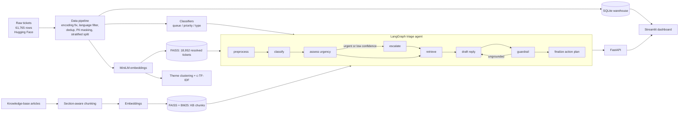

# Customer Support Intelligence Platform

**NLP + GenAI + RAG for support operations:** route tickets to the right team, score urgency with reasons, find recurring complaint themes, and draft replies grounded in company policy, all served through a FastAPI service and a Streamlit dashboard.

## Business problem

A support organisation receives thousands of tickets and cannot easily tell **what customers are unhappy about, which issues are urgent, or how to resolve them faster**. Manual triage is slow and inconsistent. Urgent tickets (outages, security incidents, double charges) wait in the same queue as routine questions, and agents rewrite answers the team has already written many times.

**Translated into AI problems:**

| Business question | AI formulation | Component |
|---|---|---|
| Which team should handle this ticket? | 10-class text classification (imbalanced) | TF-IDF/LogReg baseline → multi-task DistilBERT |
| How urgent is it, and why? | Priority classification + sentiment + risk signals → explainable 0-100 score and SLA tier | `csi/nlp/urgency.py` |
| What are customers complaining about? | Unsupervised theme discovery + spike detection | Embedding clustering + c-TF-IDF (BERTopic-style), z-test for emerging themes |
| How do we answer faster and consistently? | Retrieval-augmented generation over the knowledge base + past resolutions | FAISS + BM25 hybrid retrieval, LLM drafting with citations and a grounding guardrail |
| Which tickets can skip manual triage? | Confidence-thresholded auto-routing | Coverage-vs-precision analysis |

## Architecture



### Agentic workflow (LangGraph)

Each ticket goes through a state machine with conditional edges:

1. **preprocess**: normalise text and mask PII (emails, phones, card numbers, IPs) before anything is stored or sent to an LLM.
2. **classify**: queue, priority and ticket type with confidence scores.
3. **assess_urgency**: sentiment (RoBERTa) + predicted priority + business-risk keywords → urgency score, SLA tier (P1-P4) and human-readable drivers.
4. **escalate** (conditional): if urgency ≥ 80 or queue confidence < 60%, the ticket goes to human review and P1s page the on-call lead.
5. **retrieve**: hybrid search (dense FAISS + BM25, merged with reciprocal-rank fusion) over knowledge-base chunks, plus the most similar *resolved* tickets in the predicted queue.
6. **draft_reply**: the LLM writes a reply using only the retrieved sources and cites them (`[KB-002#0]`, `[T001234]`).
7. **guardrail**: checks that each sentence is semantically supported by a source, that citations are valid, and that no PII leaks. If the reply is not grounded, the agent **loops back** and redrafts in strict mode.
8. **finalize**: returns an action plan (queue, SLA, whether the draft needs review, escalation).

The UI shows the full step-by-step trace with timings.

## Data

- **Source:** [Tobi-Bueck/customer-support-tickets](https://huggingface.co/datasets/Tobi-Bueck/customer-support-tickets) (public; subject, body, agent answer, queue, priority, type, tags).
- **Pipeline** (`csi/data/pipeline.py`):

| Step | Rows |
|---|---|
| Raw | 61,765 |
| English only | 28,261 |
| Mojibake/escape fixes applied (ftfy) | 1,021 rows repaired |
| Empty/too-short bodies removed | 28,203 |
| Near-duplicates removed (normalised fingerprint) | −4,508 |
| **Final** | **23,695** (train 18,956 / val 2,369 / test 2,370, stratified by queue) |

- **Class imbalance:** largest-to-smallest queue ratio is **20:1** (Technical Support 6,848 vs General Inquiry 341). It is handled with class-weighted losses (`balanced` for the baseline, inverse-sqrt-frequency for DistilBERT) and reported with **macro F1**, not just accuracy.
- Clean tickets are loaded into a **SQLite warehouse** (`tickets`, `triage_log` tables). Dashboard charts are SQL queries, and the SQL is shown in the UI.
- Full report: [`reports/data_quality.json`](reports/data_quality.json).

## Results so far

### Ticket classification (test set, 2,370 tickets)

| Model | Task | Accuracy | Macro F1 | Weighted F1 |
|---|---|---|---|---|
| TF-IDF (word + char n-grams) + LogReg | Queue (10 classes) | 0.612 | 0.601 | 0.613 |
| TF-IDF + LogReg | Priority (3 classes) | 0.676 | 0.665 | 0.677 |
| TF-IDF + LogReg | Type (4 classes) | 0.880 | 0.884 | 0.881 |
| Multi-task DistilBERT | all three | *training pending, see [TODO.md](TODO.md)* | | |

Queue labels in this dataset overlap (for example "Technical Support" vs "IT Support" vs "Product Support"), so ~60% is a realistic baseline for the transformer to beat.

### Auto-routing decision analysis

Instead of routing every ticket automatically, the platform only auto-routes when the model is confident:

| Confidence threshold | Tickets auto-routed | Routing precision |
|---|---|---|
| none | 100% | 61% |
| 0.45 | 52% | 79% |
| 0.50 | 42% | 82% |
| 0.60 | 28% | 89% |
| 0.80 | 11% | 97% |

At a 0.5 threshold, **42% of tickets skip manual triage at 82% precision**. The rest go to a human with the model's suggestion pre-filled. The threshold is configurable (`CSI_ROUTE_THRESHOLD`) so operations can trade off speed against accuracy.

### Retrieval (similar resolved tickets, 300 test queries, 18,952-ticket corpus)

| Retriever | Precision@5 | MRR@5 |
|---|---|---|
| BM25 (sparse) | 0.431 | 0.776 |
| Dense (MiniLM + FAISS) | **0.452** | 0.783 |
| Hybrid (RRF) | 0.451 | **0.786** |

Relevance proxy: the retrieved ticket was handled by the same queue.

### Complaint themes

20 themes were discovered (k chosen by silhouette score). Examples: *service / outage / server* (65% high priority), *security / breach / unauthorized access*, *billing / payment / discrepancies*, *crashes / software / login*. The dashboard plots themes on a **volume × urgency prioritisation matrix**: themes in the top-right are the ones to fix first. The batch view flags **emerging themes** whose share in a new batch is significantly above the historical share (one-sided z-test).

## Features

- **Live triage demo:** paste a ticket and get queue, priority, sentiment, urgency with reasons, SLA, action plan, a cited reply draft, the retrieved sources and the agent trace.
- **Batch triage:** upload a CSV, get a prioritised work queue (sorted by urgency) as a download, plus emerging-theme alerts.
- **Thread summariser:** issue, impact, actions taken and next best action for long threads.
- **Executive overview:** KPIs, volume by queue and priority, high-priority rate by queue, and a live log of triaged tickets.
- **Model performance page:** baseline vs transformer, confusion matrix, auto-routing trade-off curve, retrieval metrics and the data-pipeline funnel.
- **Pluggable LLMs:** Groq (hosted) → Ollama (local, private) → offline extractive fallback, so the demo works without API keys.
- **Responsible AI:** PII masking, grounding check with a redraft loop, citation validation, and human review for urgent or low-confidence tickets.

## API

`uvicorn csi.api.main:app --port 8000`, interactive docs at `/docs`.

| Method | Endpoint | Purpose |
|---|---|---|
| GET | `/health` | Loaded classifier backend and LLM provider |
| POST | `/v1/classify` | Fast path (no LLM): queue, priority, type, sentiment, urgency, theme |
| POST | `/v1/classify/batch` | Up to 500 tickets, sorted by urgency |
| POST | `/v1/triage` | Full agent workflow with drafted reply |
| POST | `/v1/summarize` | Thread summary |
| POST | `/v1/search` | Hybrid KB search and similar resolved tickets |
| GET | `/v1/insights/queues` | SQL aggregate per queue |
| GET | `/v1/model/metrics` | Evaluation reports |

```bash
curl -X POST localhost:8000/v1/triage -H "Content-Type: application/json" \
  -d '{"subject": "Charged twice", "body": "I was charged twice for my annual plan and need a refund urgently."}'
```

## Run it

```bash
python -m venv .venv && .venv/Scripts/activate      # Windows (use source .venv/bin/activate on Linux/macOS)
pip install -r requirements.txt
cp .env.example .env                                  # optional: add GROQ_API_KEY or run Ollama

python -m csi.data.pipeline        # download, clean, split, load SQLite      (~1 min)
python -m csi.models.baseline      # TF-IDF + LogReg baselines                 (~5 min)
python -m csi.rag.build_index      # embeddings + FAISS indexes                (~5 min)
python -m csi.nlp.topics           # complaint themes                          (~1 min)
python -m csi.rag.evaluate         # retrieval benchmark                        (~1 min)
python -m csi.models.train --epochs 3   # multi-task DistilBERT (~2.5 h on CPU, ~10 min on a GPU)

uvicorn csi.api.main:app --port 8000
streamlit run dashboard/app.py
pytest -q
```

Docker (after running the pipeline once so `artifacts/` exists): `docker compose up --build` serves the API on `:8000` and the dashboard on `:8501`.

## Project structure

```
csi/
  config.py            settings (env-overridable)
  text.py              PII masking, text helpers
  data/pipeline.py     ingestion -> cleaning -> dedup -> split -> SQLite
  models/              baseline, multi-task DistilBERT, training loop, metrics, predictor
  nlp/                 sentiment, urgency scoring, theme discovery
  rag/                 chunking, embeddings, index build, hybrid retriever, retrieval eval
  llm.py               Groq / Ollama / offline provider
  genai.py             grounded reply drafting, summarisation, grounding guardrail
  agent.py             LangGraph triage workflow
  service.py           shared business logic + triage log
  api/main.py          FastAPI app
dashboard/app.py       Streamlit UI
data/knowledge_base/   sample help-center articles (fictional company)
reports/               evaluation outputs (JSON)
tests/                 unit tests
```

## Tech stack

Python, pandas, scikit-learn, PyTorch, Hugging Face Transformers (DistilBERT, RoBERTa), Sentence-Transformers, FAISS, BM25, LangGraph, Groq / Ollama LLMs, FastAPI, Streamlit, Plotly, SQLite, Docker, pytest.

## Roadmap

See [TODO.md](TODO.md) for the long-running jobs and next phases.
